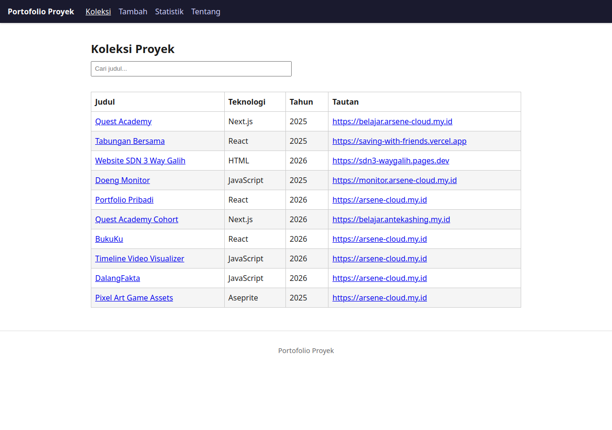

# Nama Aplikasi

*PORTOFOLIO PROYEK PRIBADI*

Nama: Reksa Ariel Saputra
NIM: 124140119
Kelas: RB
Tema: Portofolio Proyek Pribadi
Deployment: https://arSene-dot.github.io/uts-paw/



## Fitur

Halaman Koleksi: menampilkan daftar proyek dari file JSON.
Halaman Tambah: form untuk menambah proyek baru.
Halaman Detail: menampilkan detail satu proyek dan bisa dihapus
Halaman Statistik: tabel jumlah proyek per kategori.
Halaman Tentang: menampilkan nama dan NIM.
Halaman 404 untuk alamat yang tidak dikenal, dan fallback 404.html agar refresh di GitHub Pages tetap membuka aplikasi.

## Menjalankan secara lokal

cd app
npm install
npm run dev

## Konsep React yang dipakai

Komponen: potongan UI yang dipakai ulang (Navbar, Footer, tabel, form).
Props: data dari komponen induk ke anak.
State (useState): data yang bisa berubah, mis. kata kunci pencarian.
Effect (useEffect): kode saat halaman dibuka, mis. ambil data JSON.
Context: berbagi data ke banyak halaman tanpa oper props.
Custom Hook: fungsi sendiri dari hook React (useKoleksi, useLocalStorage).
Router: pindah halaman tanpa reload (Routes, Link, useParams, useNavigate).
Fetch: ambil data (async/await), tampil loading/error.
Map + key: tampilkan daftar, tiap baris punya key unik.
Conditional rendering: tampilan menyesuaikan kondisi.
Controlled form: isi input disimpan di state, validasi sendiri.
localStorage: data tersimpan di browser, tidak hilang saat refresh.
```
