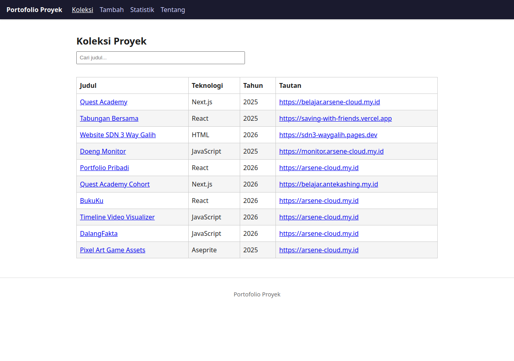

# Portofolio Proyek

Nama: Reksa Ariel Saputra
NIM: 124140119
Tema: portofolio proyek
URL deployment: https://arsen-dot.github.io/uts-paw/

## Fitur

- Halaman Koleksi: mengambil data dari `public/data/koleksi.json` dengan
  `fetch`, pencarian berdasarkan judul (kata kunci tersimpan di localStorage).
- Halaman Tambah: form terkontrol dengan validasi JavaScript sendiri
  (hanya Judul yang wajib diisi); item baru tersimpan ke localStorage dan
  muncul di Koleksi.
- Halaman Detail: menampilkan Teknologi, Tahun, dan Tautan; tombol Hapus
  dengan konfirmasi `window.confirm`, lalu kembali ke Koleksi.
- Halaman Statistik: tabel jumlah proyek per Kategori, per Teknologi, dan
  per Tahun.
- Halaman Tentang: menampilkan nama dan NIM dari `mahasiswa.json`.
- Halaman 404 untuk rute yang tidak dikenal, plus `404.html` sebagai
  fallback saat refresh di GitHub Pages.
- Layout semantik (`header`, `nav`, `main`, `footer`) dan CSS responsif.

## Cara Menjalankan

```
npm install
npm run dev
```

Perintah lain yang tersedia: `npm run build` untuk build produksi,
`npm test` untuk menjalankan test, dan `npm run lint` untuk lint.

## Tangkapan Layar


